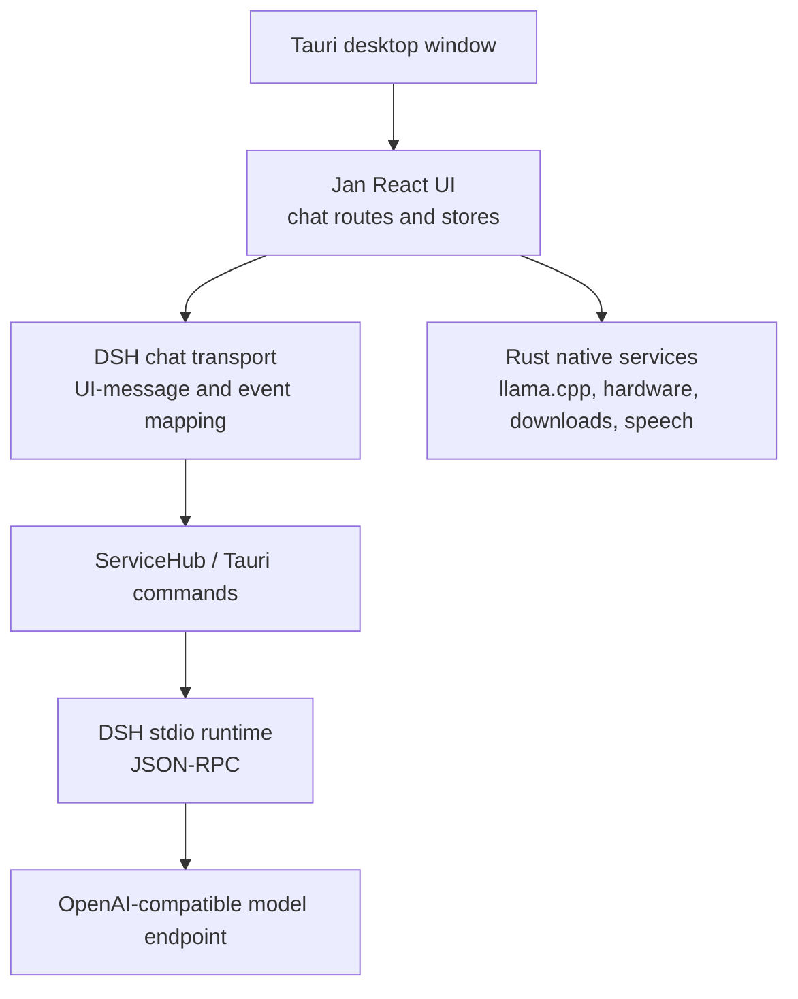
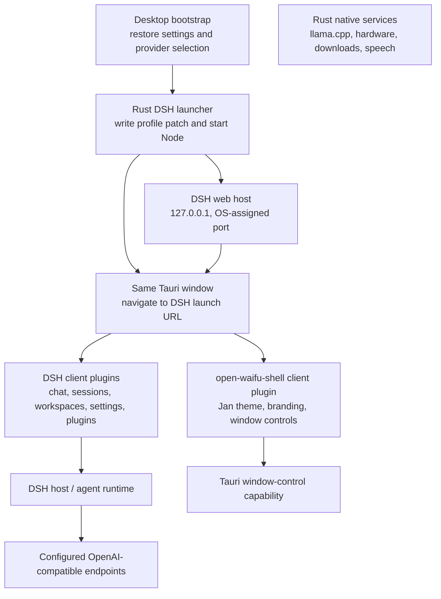
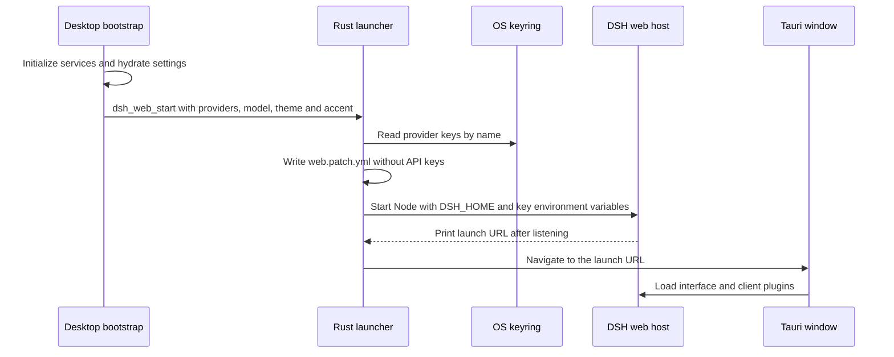
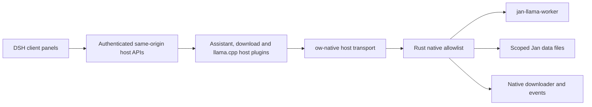

# Desktop architecture: moving the interface onto DSH

This fork is moving from a Jan React interface backed by DeepSeek Harness (DSH) to a desktop window that displays DSH's own web interface. Jan's appearance and app-specific features are being added as DSH plugins. Tauri and Rust continue to own native resources.

**Status:** experimental migration. The single-window cutover is committed in `223399397`. Remote chat, selected-local-model handoff, saved DSH sessions, UI plugin installation, and the converted assistant, download and llama.cpp feature plugins have been exercised in the desktop app. Full Jan layout parity and packaged-release readiness are unfinished. This document distinguishes verified behavior from planned work.

## Why change the architecture?

The earlier integration used DSH for agent execution while retaining Jan's chat interface. That left the app translating DSH messages, sessions, tools and interaction states into a second UI model.

Using DSH's interface gives those features one owner. The fork can focus on its chat experience, appearance and native model services, while DSH supplies the session UI, agent runtime and plugin system.

## 1. Before: Jan renders the conversation

The first DSH integration replaced the agent backend but kept Jan's React routes and chat transport.



Jan owned the visible conversation. DSH owned agent execution. The transport had to keep both representations aligned. A later prototype exposed both the Jan UI and a separate DSH shell, which also left two navigation destinations to maintain.

## 2. Now: DSH renders the desktop interface

The desktop entry is a small bootstrap. After restoring settings, it asks Rust to start DSH and navigates the same native window to the host's loopback URL.



The native services remain in the application. Feature plugins call them through the scoped host bridge described in section 6. Remote chat continues to use the configured endpoint directly.

There is one desktop destination. The old shell selector, return-to-Jan action and `?shell=jan` escape have been removed. Some legacy React routes and the stdio transport remain in source during migration; the desktop entry does not load that route tree.

## 3. Responsibilities by layer

| Layer | Responsibility | Current state |
|---|---|---|
| Tauri desktop app | Window lifecycle, navigation and native permissions | Active |
| React desktop bootstrap | Initialize ServiceHub, restore persisted settings, request DSH startup, show startup failures and Retry | Active |
| Rust DSH launcher | Locate the CLI and bundled shell plugin, generate startup configuration, supervise the Node child process | Active |
| DSH web host and built-in plugins | Conversation UI, DSH sessions, workspaces, agent execution, settings and plugin management | Active |
| `ow-shell` host plugin | Serve a fixed set of font/logo assets and provide appearance configuration to the client | Active |
| `ow-shell` client plugin | Apply Jan identity (palette, fonts, wordmark, hand mark, line icons) and Jan's navigation positions over DSH's own chat layout; expose native window buttons | Active |
| Native feature host plugins | Own assistant storage, model management and download tasks through `ow-native` | Implemented; flow verification continues |
| Rust model and device services | llama.cpp worker, hardware, downloads and other native operations | Active behind the scoped host bridge |
| Legacy Jan routes and stdio adapter | Earlier frontend and runtime integration | Still present in source; scheduled for removal after migration |

DSH sessions live in the app's isolated DSH home. Existing Jan thread files are not automatically converted by the shell cutover.

## 4. Startup and configuration



- **Runtime:** the harness is vendored at `deepseek-harness/` with the layout and local compaction changes. `make dsh` builds it (Node >=24.9) and the app runs its `apps/cli/lib/bin.js`; `OW_DSH_CLI` overrides that path. The stock npm release does not contain these APIs. A release bundle that ships the built harness inside the app is still needed.
- **State:** `<Jan data>/dsh/web-home` is passed as `DSH_HOME`. The app does not use the user's ordinary `~/.dsh` state.
- **Configuration:** `<Jan data>/dsh/web.patch.yml` adds the shell plugin, appearance settings, active remote provider routes and the selected model when that route is available.
- **Secrets:** Rust reads API keys from the OS keyring and passes them to the host through `OW_PROVIDER_KEY_<i>` environment variables. They are excluded from the patch file.
- **Navigation:** Rust performs the initial navigation so DSH's SameSite=Strict launch cookie works across the redirect.
- **Lifecycle:** the launcher reuses an unchanged running host, restarts it when setup changes and stops it with the app.

## 5. Plugin boundaries

A DSH package can have a host half and a browser half:

```text
open-waifu-shell/
├── index.mjs       # Node: appearance configuration and allowlisted assets
├── client.js       # Browser: theme, slots, footer actions, native window buttons
├── package.json    # DSH client declaration and module exports
└── assets/         # Fonts and logo served by the host half
```

The current client uses DSH's slot, locale, theme and layout services. Its branding contributions use priority `-1`; another plugin can replace those branding seats at `-2` or lower. The Plugin manager and Settings footer actions open DSH's existing panels.

**The current native exception is window control.** The shell's browser code can call the narrowly granted Tauri window APIs. That permission does not give arbitrary DSH plugins access to model loading, the filesystem or other native services.

### Jan identity on DSH's layout

The chat area, composer and transcript are DSH's own. Exact Jan layout parity was dropped. The shell keeps Jan's identity and the places Jan users look for things: New Chat, New project and Search rows, a plain Chats list (blank sessions hidden, as in Jan), Model Hub, Plugin manager and Settings in the footer, and the model pill at the top left.

DSH's composition system tracks child-outlet ownership, so the shell does not replace parents. The matching runtime exposes focused slots for sidebar actions and headings, the hero, the composer placeholder, the header model selector and plugin card artwork, plus a `data-blank` marker on blank session rows. The shell fills those slots while DSH keeps its callbacks, model directory and session state. The global DSH installation is unchanged.

## 6. Native feature plugins

The retained assistant, download and llama.cpp implementations now have DSH host plugins and client panels. Their package names use `@open-waifu/dsh-<feature>`, registration ids use `ow-<feature>`, and service keys use `ow<Feature>`.



Rust starts a loopback-only native API with a per-launch bearer token. Only the Node host receives that token. The bridge accepts a fixed operation allowlist and checks native file scopes. Browser panels call DSH-authenticated host routes; they do not receive the native bearer or a generic Tauri invoke endpoint. Window controls retain their separate narrow Tauri capability.

| Plugin | Responsibility | Observed desktop coverage |
|---|---|---|
| `ow-native` | Native requests and event delivery, host only | Rust handled engine and assistant calls |
| `ow-log-bridge` | DSH warnings, errors and session activation failures to the app log (adapted from dataelement/dsh-desktop, MIT) | e2e run: `[dsh-log]` warnings appear at WARN level in the app log |
| `ow-assistant` | Legacy Jan assistant import into DSH agent presets, plus the Custom instructions editor | Imported assistants appear as presets; the editor creates and edits them, and conversations switch preset at a turn boundary |
| `ow-download` | Model import tasks, progress and pause/resume/cancel | Real 1.1 MiB GGUF URL import reached Completed at 100%; scratch model removed afterward. Pause/resume/cancel remain under verification |
| `ow-llamacpp` | Engine lifecycle, installed models, imports, catalog and settings | Installed list, hardware status, GGUF lookup and fresh Minimal-mode local chat exercised |
| `ow-shell` | Appearance, branding, asset serving and native window buttons | Active; checked by the desktop e2e |
| `ow-server` | Retained stdio protocol for remaining legacy callers | Separate from the desktop web-host path |

Assistant storage and llama.cpp business logic have one shared source under `dsh/`; retained legacy callers import those sources. The native worker and Jan data paths are unchanged. Previously removed RAG and vector-storage implementations are not reintroduced.

Fresh and reopened Minimal-mode sessions selected Jan-v3.5-4B through the local adapter and returned the requested responses, including `local-priority-ok`. The provider migrates saved `llamacpp` selections to `ow-llamacpp` through DSH's durable session APIs. Per-model compaction policies register separately for each preset's isolated backend through the matching runtime's public registration API. The model keeps its reported 8,192-token capacity; registration does not inflate that capacity.

The import walkthrough found and corrected a native bridge validation mismatch: the engine uses `provider/model` task ids, while the new boundary initially rejected `/`. A real GGUF URL import then completed with native progress in the desktop. Pause/resume and cancellation still need their own walkthrough. Speech remains a native service; voice controls have not moved into a DSH panel yet.

## 7. Code map

| File | Role |
|---|---|
| `web-app/vite.config.ts` | Selects the desktop entry for Tauri builds |
| `web-app/src/main-desktop.tsx` | Starts the minimal desktop bootstrap |
| `web-app/src/providers/ServiceHubProvider.tsx` | Initializes services, hydrates settings and starts the shell |
| `web-app/src/lib/dsh-shell.ts` | Builds the provider/model/appearance handoff |
| `web-app/src/services/dsh/` | ServiceHub interface and Tauri command adapter |
| `src-tauri/src/core/dsh/commands.rs` | Exposes desktop DSH commands and initiates navigation |
| `src-tauri/src/core/dsh/web.rs` | Generates the patch and supervises the web host |
| `src-tauri/src/core/dsh/native.rs` | Loopback native bridge with bearer auth and an operation allowlist |
| `src-tauri/capabilities/dsh-shell.json` | Limits the remote shell's native window permissions |
| `dsh/native/` | `ow-native` host transport |
| `dsh/log-bridge/` | `ow-log-bridge` runtime log export |
| `dsh/templates/ui-plugin/` | Starting template for a new UI plugin (see `dsh/README.md`) |
| `scripts/e2e-desktop.mjs` | End-to-end check of the real desktop build |
| `dsh/assistant/` | `ow-assistant` store and host, shared with legacy callers |
| `dsh/download/` | `ow-download` import tasks and client panel |
| `dsh/llamacpp/` | `ow-llamacpp` engine runtime, local provider and client panel |
| `dsh/open-waifu-shell/` | App-specific DSH host/client plugin |

## 8. Verification and remaining work

`node scripts/e2e-desktop.mjs` launches the debug build on a temporary Jan data root and drives the window over the WebView2 DevTools protocol. It checks the sidebar controls, that no blank chat row is listed, that the log bridge loaded, that Settings and the Plugin manager open, that an experimental bundle applies live (its Discover tab appears without a reload), and optionally installs a local plugin folder and waits for a real reply. Setup and flags are in `dsh/README.md`. The latest runs passed every step with Jan's configured providers.

Selected local-model startup was verified earlier with a completed Minimal-mode turn and reload. Automatic migration of old Jan chats and packaged-release readiness remain unverified.

Remaining work:

- Bundle apply takes 13 to 20 s in the host's HMR reconcile before the bundle's UI appears.
- Finish native import/download pause, resume and cancel verification.
- Add voice controls through a DSH plugin if that work is requested.
- Package a pinned DSH runtime with the application.
- Remove the obsolete Jan UI and stdio paths once their required behavior has moved.

See [the migration plan](plans/2026-11-13-dsh-host-shell.md) for the implementation sequence.
