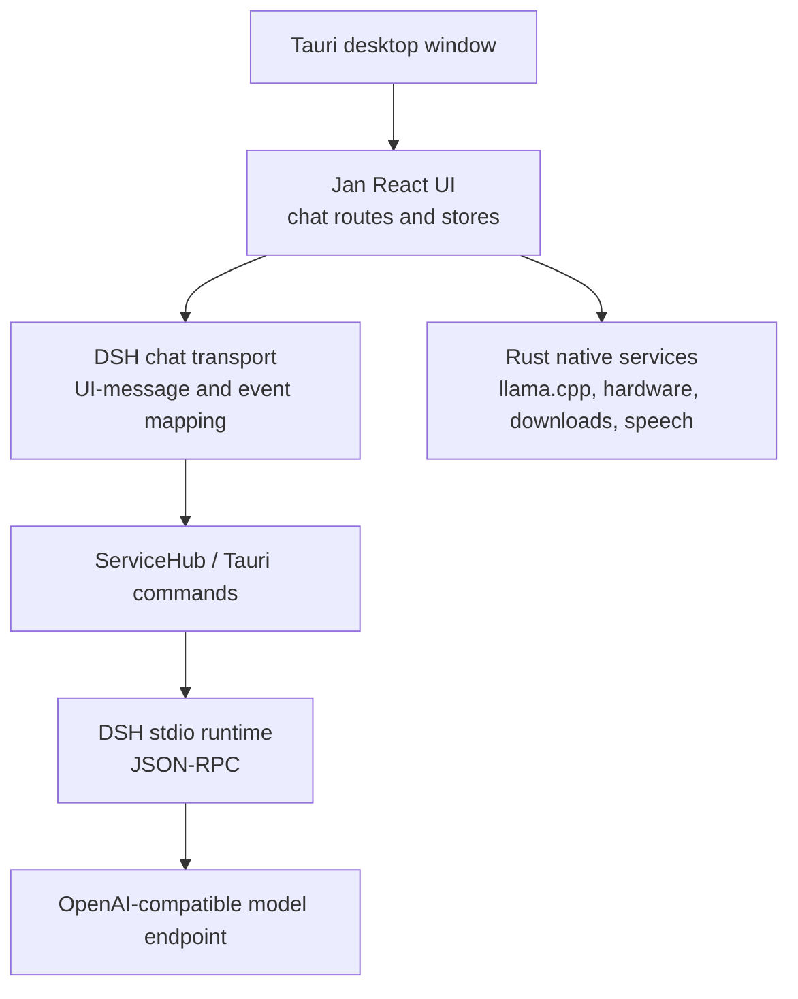
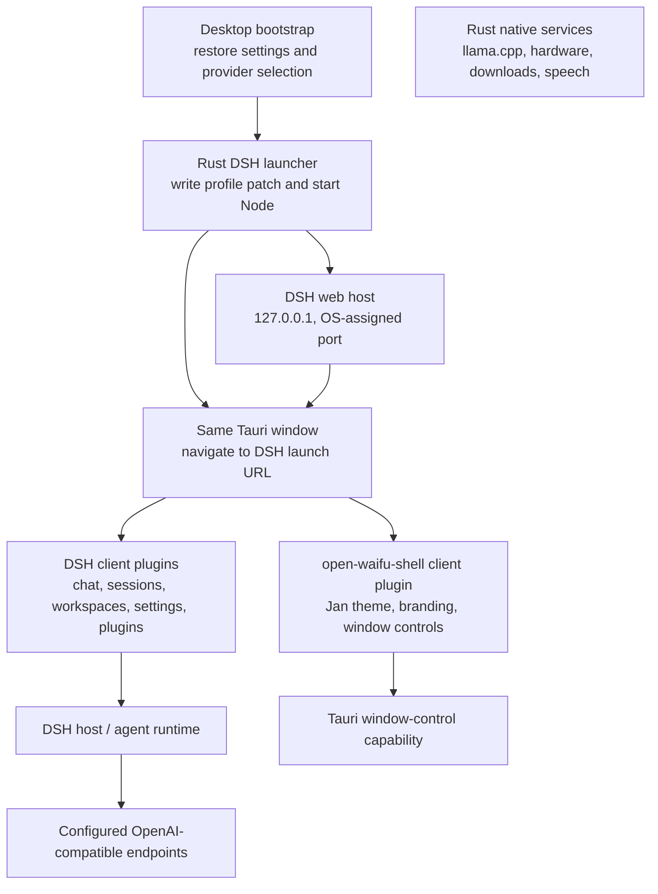
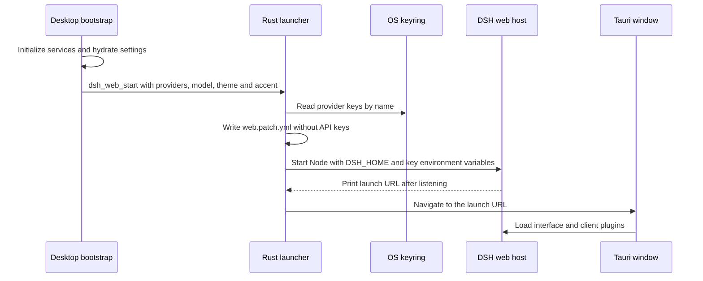

# Desktop architecture: moving the interface onto DSH

This fork is moving from a Jan React interface backed by DeepSeek Harness (DSH) to a desktop window that displays DSH's own web interface. Jan's appearance and app-specific features are being added as DSH plugins. Tauri and Rust continue to own native resources.

**Status:** experimental migration. The single-window cutover is committed in `223399397`. Remote chat, saved DSH sessions and UI plugin installation have been exercised in the desktop app. Local-model handoff, native feature screens and full Jan layout parity are unfinished. This document distinguishes the committed path from planned work.

## Why change the architecture?

The earlier integration used DSH for agent execution while retaining Jan's chat interface. That left the app translating DSH messages, sessions, tools and interaction states into a second UI model.

Using DSH's interface gives those features one owner. The fork can focus on its chat experience, appearance and native model services, while DSH supplies the session UI, agent runtime and plugin system.

## 1. Before: Jan renders the conversation

The first DSH integration replaced the agent backend but kept Jan's React routes and chat transport.



Jan owned the visible conversation. DSH owned agent execution. The transport had to keep both representations aligned. A later prototype exposed both the Jan UI and a separate DSH shell, which also left two navigation destinations to maintain.

## 2. Now: DSH renders the desktop interface

The desktop entry is a small bootstrap. After restoring settings, it asks Rust to start DSH and navigates the same native window to the host's loopback URL.



The native services remain in the application, but their full integration into DSH is still pending. The diagram deliberately leaves them outside the verified remote-chat path.

There is one desktop destination. The old shell selector, return-to-Jan action and `?shell=jan` escape have been removed. Some legacy React routes and the stdio transport remain in source during migration; the desktop entry does not load that route tree.

## 3. Responsibilities by layer

| Layer | Responsibility | Current state |
|---|---|---|
| Tauri desktop app | Window lifecycle, navigation and native permissions | Active |
| React desktop bootstrap | Initialize ServiceHub, restore persisted settings, request DSH startup, show startup failures and Retry | Active |
| Rust DSH launcher | Locate the CLI and bundled shell plugin, generate startup configuration, supervise the Node child process | Active |
| DSH web host and built-in plugins | Conversation UI, DSH sessions, workspaces, agent execution, settings and plugin management | Active |
| `open-waifu-shell` host plugin | Serve a fixed set of font/logo assets and provide appearance configuration to the client | Active |
| `open-waifu-shell` client plugin | Apply Jan styling, register branding/footer contributions and expose native window buttons | Active; exact layout parity incomplete |
| Rust model and device services | llama.cpp worker, hardware, downloads and other native operations | Retained; DSH integration incomplete |
| Legacy Jan routes and stdio adapter | Earlier frontend and runtime integration | Still present in source; scheduled for removal after migration |

DSH sessions live in the app's isolated DSH home. Existing Jan thread files are not automatically converted by the shell cutover.

## 4. Startup and configuration



- **Runtime:** development currently uses the global `@deepseek-ai/dsh` installation, version 0.2.2. `OW_DSH_CLI` can select another built CLI entry. A packaged, app-managed runtime is still needed.
- **State:** `<Jan data>/dsh/web-home` is passed as `DSH_HOME`. The app does not use the user's ordinary `~/.dsh` state.
- **Configuration:** `<Jan data>/dsh/web.patch.yml` adds the shell plugin, appearance settings, active remote provider routes and the selected model when that route is available.
- **Secrets:** Rust reads API keys from the OS keyring and passes them to the host through `OW_PROVIDER_KEY_<i>` environment variables. They are excluded from the patch file.
- **Navigation:** Rust performs the initial navigation so DSH's SameSite=Strict launch cookie works across the redirect.
- **Lifecycle:** the launcher reuses an unchanged running host, restarts it when setup changes and stops it with the app.

## 5. Plugin boundaries

A DSH package can have a host half and a browser half:

```text
open-waifu-shell/
├── index.mjs       # Node: appearance configuration and allowlisted assets
├── client.js       # Browser: theme, slots, footer actions, native window buttons
├── package.json    # DSH client declaration and module exports
└── assets/         # Fonts and logo served by the host half
```

The current client uses DSH's slot, locale, theme and layout services. Its branding contributions use priority `-1`; another plugin can replace those branding seats at `-2` or lower. The Plugin manager and Settings footer actions open DSH's existing panels.

**The current native exception is window control.** The shell's browser code can call the narrowly granted Tauri window APIs. That permission does not give arbitrary DSH plugins access to model loading, the filesystem or other native services.

### Why Jan layout parity needs more work

DSH's composition system tracks child-outlet ownership. Registering a replacement parent with child outlets that already exist is rejected. A replacement component also cannot assume it has permission to render another entry's children.

That affects larger changes such as replacing the sidebar structure, moving the model picker into the header and rearranging the composer while preserving third-party contributions.

The supported leaf slots and theme hooks already allow branding and smaller contributions. Full layout replacement needs an appropriate host extension point, such as lifecycle-safe entry decoration or more focused layout slots. No installed DSH bundles are being patched to bypass this restriction.

## 6. Native integration target

The intended next step is a DSH host-side bridge to Rust's native services, with client plugins for the corresponding screens.

| Planned path | What it enables |
|---|---|
| DSH model provider → native engine bridge → llama.cpp worker | Local model selection and inference |
| Model Hub client plugin → host bridge → native downloads | Model browsing, download progress and installation |
| Engine settings client plugin → host bridge → Rust hardware/engine services | Device and inference configuration |
| Voice client plugin → host bridge → speech services | Dictation and read-aloud controls |

The transport, authentication and permission contract for this bridge remain design work. The current window-control capability must not be expanded into unrestricted native access.

A selected-local-model startup and endpoint-handoff fix is in progress outside the documented checkpoint. It has passed TypeScript and Rust checks, but has not yet been verified with a real local-model conversation. It is not included in the verified architecture above.

## 7. Code map

| File | Role |
|---|---|
| `web-app/vite.config.ts` | Selects the desktop entry for Tauri builds |
| `web-app/src/main-desktop.tsx` | Starts the minimal desktop bootstrap |
| `web-app/src/providers/ServiceHubProvider.tsx` | Initializes services, hydrates settings and starts the shell |
| `web-app/src/lib/dsh-shell.ts` | Builds the provider/model/appearance handoff |
| `web-app/src/services/dsh/` | ServiceHub interface and Tauri command adapter |
| `src-tauri/src/core/dsh/commands.rs` | Exposes desktop DSH commands and initiates navigation |
| `src-tauri/src/core/dsh/web.rs` | Generates the patch and supervises the web host |
| `src-tauri/capabilities/dsh-shell.json` | Limits the remote shell's native window permissions |
| `dsh/open-waifu-shell/` | App-specific DSH host/client plugin |

## 8. Verification and remaining work

At the committed checkpoint, the desktop flow was exercised with a configured remote endpoint: send a message, receive a reply, reopen the saved DSH session after reload, open Settings, and install, enable, reload, disable and remove a separate UI plugin.

These observations do not establish local-model support, automatic migration of old Jan chats, complete Jan visual parity or packaged-release readiness.

Remaining work:

- Verify selected local-model startup and endpoint handoff in the native app.
- Resolve the public composition seam needed for Jan's sidebar, header and composer layout.
- Add native Model Hub, engine and voice screens through DSH plugins.
- Package a pinned DSH runtime with the application.
- Remove obsolete Jan UI and stdio paths after their required behavior has moved.

See [the migration plan](plans/2026-11-13-dsh-host-shell.md) for the implementation sequence.
