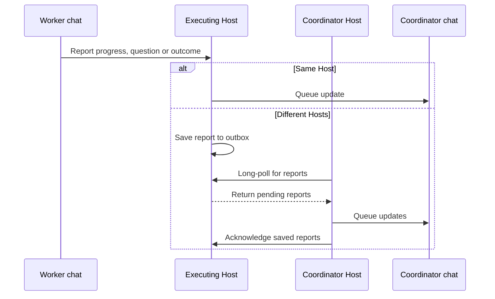

# Orchestration

Orchestration runs a set of background worker chats from one coordinator chat, on the same Jan Host or across connected Hosts.

## Use it

Ask a regular chat: “Use orchestration to split this release into two tasks: update the changelog here and review the examples in the Docs project on my other computer. Once both finish, summarize their results.” The Orchestration sidebar tab shows the current chat's tasks and opens their worker chats. Stopping a task leaves its chat and worktree in place; stopping one whose worker is still being created waits for that chat and worktree to be recorded, then stops it. To retry, ask the coordinator to reuse the task with `retry_of`.

## How workers report back

Workers can give progress updates, ask for a decision, or report a final outcome. A report wakes an idle coordinator or queues behind its active turn. If the coordinator is archived or unavailable, the update remains visible in the Orchestration panel and is eligible for redelivery on Host startup. Dependencies start only after all prerequisite tasks succeed.

## Other computers

Connect a peer in **Settings > Hosts**. For SSH peers, the worker opens in this Jan window. For Address Hosts, the panel opens the other Jan window. If an Address Host rejects its saved token after a restart, save its current tokenized link again.

| Operation | What happens |
| --- | --- |
| Pull | The coordinator Host long-polls for up to 25 seconds at a time while its peer has active dispatches. |
| Acknowledge | The coordinator Host records its progress and acknowledges those reports to the executing Host. It resumes any outstanding acknowledgement after restart. |
| Retain | The executing Host keeps a report in its outbox until the coordinator acknowledges it. Replayed reports keep their original delivery IDs. |
| Stop | Stopping a task whose Host is unreachable stops it here at once and tells the coordinator; the coordinator Host keeps retrying until that Host stops the worker. If the Host answers and refuses the stop, the task stays stopped here and the stop is not retried. A stopped worker is cancelled even if saving the stop fails. |
| Start | A start that gets no answer or a temporary (5xx) failure is retried with the same dispatch for about half a minute, and the Host treats the retry as the same start. A Host answers 5xx when a start fails after it saved the worker, so the retry resumes that worker. A start the Host refuses fails the task at once. After the last retry the task fails and the Host is sent a stop, in case the worker started there. Stopping a task stops its retries and sends that stop too; a Host that gets a stop before its start remembers the dispatch and refuses that start. |
| Scope | The executing Host lets only the coordinator Host that started a worker message, stop or read it. |

## Worker mode

A worker chat starts in Code mode (the `standard` preset) when its Host has that preset, because workers edit files and run commands. This holds even where new chats start in Chat mode, as on Desktop. The coordinator can pass another preset as `mode` on a task, or an agent profile as `agent`.

## Local data

Task and message state is stored in `$JAN_HOME/orchestration/state.json`. Git worktrees normally live under `<project>/.agents/worktrees/`; orchestration never removes those directories or their branches. With no worktree service, the Git fallback disables hooks and skips Git LFS smudging, but other repository-configured checkout filters still run like a manual `git worktree add`. A Git checkout failure starts the worker in the shared project folder and leaves the reason on the task.

The file keeps at most 2,000 messages. Past that, the oldest delivered messages go first, then the oldest reports held for an archived coordinator chat; other undelivered reports are never dropped. A held report reaches its coordinator if the chat is restored before Jan restarts. A report whose coordinator chat was deleted is retired at once. When a save fails, the change stays in memory and the call that made it reports the error; Jan retries the save every five seconds, and once one succeeds it delivers waiting reports, starts tasks whose dependencies finished and resumes interrupted starts, as it does at startup. A peer Host is acknowledged only up to updates that are saved.

For each saved peer, `peerCursors` records the latest durably received sequence and `peerAcks` records the latest sequence whose acknowledgement succeeded. A Host restart retries only outstanding acknowledgements. Removing a peer in Hosts settings clears both entries.

## Model Experience

### Coordinator and worker tools

#### What the model sees

Every top-level non-worker chat gets the six coordinator tools. A worker chat gets only the three worker tools. Subagents get neither set. The coordinator can view tasks and report back without waiting for a worker turn to end.

#### Token effect

The table counts each registered tool description and its serialized input JSON Schema (compact `JSON.stringify(def.parameters)`), divided by four. The coordinator set totals 2,864 characters (716 estimated tokens); the worker set totals 903 characters (about 226 estimated tokens). Turn messages and tool results are additional and not included in these schema estimates.

| Role | Tool | Characters | Estimated tokens |
| --- | --- | ---: | ---: |
| Coordinator | `orchestration_targets` | 153 | 38 |
| Coordinator | `orchestration_start` | 1,445 | 361 |
| Coordinator | `orchestration_tasks` | 293 | 73 |
| Coordinator | `orchestration_send` | 518 | 130 |
| Coordinator | `orchestration_read` | 241 | 60 |
| Coordinator | `orchestration_stop` | 214 | 54 |
| Worker | `orchestration_report` | 190 | 48 |
| Worker | `orchestration_ask` | 318 | 80 |
| Worker | `orchestration_done` | 395 | 99 |

#### KV Cache effect

Tool schemas remain stable for each chat role. A worker brief and subsequent reports, questions, and replies enter the relevant chat as new messages rather than replacing earlier context.

## Known Limitations and Deferred Work

- Address Hosts do not expose their worker sessions in the coordinator Host's sidebar; open the executing Host from the panel to see those chats.
- Failure does not dispatch dependents. Retry the failed task, or stop tasks that should no longer wait for it.
